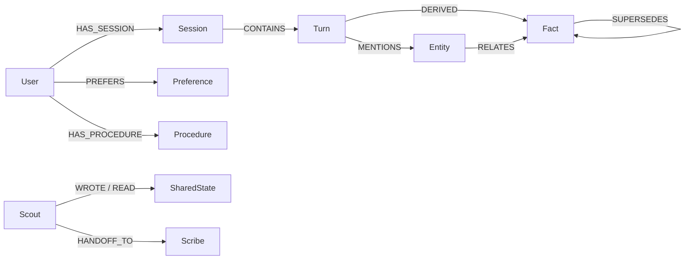

# Continuum

**Cross-agent graph memory with explainable recall.**
Built for [Graph Hacks: Context for AI Agents](https://www.wemakedevs.org/hackathons/falkordb) (FalkorDB) — Track 02: Agent Memory & Coordination.

An AI assistant that remembers you — and shows you why it remembers. Two agents
(**Scout** finds/extracts, **Scribe** summarizes/acts) share persistent memory
stored as a property graph in FalkorDB:

- **Episodic** — sessions and turns with timestamps
- **Semantic** — facts and entities, extracted and linked
- **Procedural** — preferences and learned procedures

Every user gets an isolated graph inside a single FalkorDB instance
(multigraph topology = one tenant brain per graph). Every answer ships with a
**memory trace**: the exact nodes and edges traversed and the Cypher that
fetched them, rendered live as a subgraph beside the chat.

## Quickstart

```bash
# 1. Start FalkorDB (with persistent volume) + backend
docker compose up --build

# 2. Verify the graph round-trip
python scripts/verify_graph.py

# 3. Frontend (dev)
cd frontend && npm install && npm run dev
```

- FalkorDB Browser: http://localhost:3000
- Backend API: http://localhost:8000/health
- Frontend: http://localhost:5173

Copy `.env.example` to `.env` and add your `GEMINI_API_KEY` (free tier at
https://aistudio.google.com) or `GROQ_API_KEY`.

## Graph model

One FalkorDB instance, one graph per user (`user:{id}`) via multigraph
topology. Full rationale in [docs/graph-model.md](docs/graph-model.md).



| Memory type | Nodes | What it answers |
|---|---|---|
| Episodic | `Session`, `Turn` | what happened, and when |
| Semantic | `Entity`, `Fact` | what is true (with temporal validity) |
| Procedural | `Preference`, `Procedure` | how this user likes things done |
| Coordination | `SharedState`, `HANDOFF_TO` | what agents tell each other |

## API

| Route | What it does |
|---|---|
| `POST /chat` | Ask Scribe (answer) or Scout (research); returns the memory trace |
| `GET /memory?user_id=` | Sessions, facts, preferences, procedures, shared state |
| `GET /memory/subgraph?user_id=&node_ids=` | Cytoscape elements for traced nodes + neighbors |
| `GET /agents?user_id=` | Agents and their handoff history |
| `GET /health` | Backend + FalkorDB status |

## Performance

Measured with `scripts/bench_concurrent.py` — the graph workload the chat
path runs (turn writes, preference writes, fact/turn/preference reads),
50 isolated tenant graphs under 32 concurrent threads, local Docker
FalkorDB, steady state:

| metric | value |
|---|---|
| Throughput | ~4,300 ops/s |
| Reads p50 / p95 | ~3 ms / ~7 ms |
| Writes p50 / p95 | ~6 ms / ~12 ms |

First-run against cold graphs pays an index-build tax (writes p95 ~90 ms),
then settles into the numbers above. Per-user multigraph isolation means no
tenant can starve another's query planning. Run it yourself:
`python scripts/bench_concurrent.py`.

## Cypher queries the product depends on

See [docs/cypher.md](docs/cypher.md).

## License

MIT

Built with AI coding assistance, disclosed per Graph Hacks rules.
