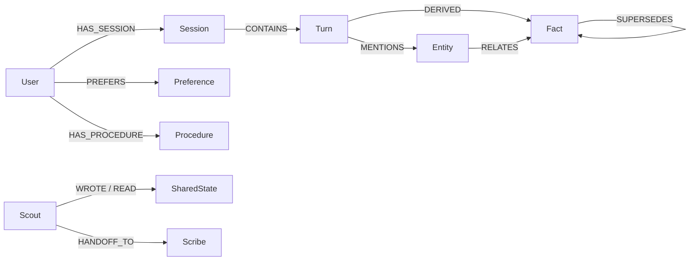

# Continuum

**Cross-agent graph memory with explainable recall.**
Built for [Graph Hacks: Context for AI Agents](https://www.wemakedevs.org/hackathons/falkordb) (FalkorDB) — Track 02: Agent Memory & Coordination.

**Stack:** Python + FastAPI · FalkorDB (Docker) · React + cytoscape.js · Gemini
for fact extraction and answering.

An AI assistant that remembers you — and shows you why it remembers. Two agents
(**Scout** finds/extracts, **Scribe** summarizes/acts) share persistent memory
stored as a property graph in FalkorDB:

- **Episodic** — sessions and turns with timestamps
- **Semantic** — facts and entities, extracted and linked
- **Procedural** — preferences and learned procedures

Every user gets an isolated graph inside a single FalkorDB instance
(multigraph topology = one tenant brain per graph). Every answer ships with a
**memory trace**: the exact nodes and edges traversed and the Cypher that
fetched them, rendered live as a subgraph beside the chat.

## Quickstart

Prerequisites: Docker Desktop, Python 3.10+, Node 18+.

```bash
# 1. Backend deps (for scripts and tests)
pip install -r backend/requirements.txt

# 2. Start FalkorDB (with persistent volume) + backend
docker compose up --build

# 3. Verify the graph round-trip
python scripts/verify_graph.py

# 4. Frontend (dev)
cd frontend && npm install && npm run dev
```

- FalkorDB Browser: http://localhost:3000
- Backend API: http://localhost:8000/health
- Frontend: http://localhost:5173

Copy `.env.example` to `.env` and add your `GEMINI_API_KEY` (free tier at
https://aistudio.google.com) or `GROQ_API_KEY`.

## Live demo

**http://16.4.24.249** — AWS EC2 (`t3.small`, ap-south-1) running the full
stack via `docker-compose.prod.yml`: FalkorDB + FastAPI backend + nginx
serving the React build, all behind one public URL.

## Deploying it yourself

The production stack is `docker-compose.prod.yml` (FalkorDB + backend +
nginx frontend — one URL, no separate dev server). To deploy:

```bash
# on any Docker host with the repo cloned and a .env in place:
docker-compose -f docker-compose.prod.yml up -d --build
curl -X POST http://<host>/seed   # populate the demo graph
```

The nginx container serves the built React app and proxies `/chat`,
`/memory`, `/agents`, `/health`, `/seed`, and `/session_turns` to the
backend. The frontend build runs inside Docker (multi-stage), so the host
never needs Node.

## What to try

Open http://localhost:5173 (Alice/Bob user switcher in the header) and run
this arc — each step lights up a different part of the memory graph:

1. **Write a memory** — "I prefer TypeScript for new projects."
   The trace panel shows episodic → semantic → procedural retrieval with the
   Cypher behind each step — click any node to inspect its properties and the
   query that fetched it.
2. **Change your mind** — "Update: TypeScript is preferred for mobile apps now."
   The old fact gains a `SUPERSEDES` edge and leaves retrieval; the answer
   cites only the current fact. The graph shows *why* the answer changed.
3. **Rewind** — "What did I prefer before TypeScript" (no `?` needed). A
   variable-length `SUPERSEDES` walk reconstructs the chain; the trace panel
   labels these steps **temporal** and the answer narrates the history.
4. **Cold handoff** — switch the mode toggle to **Scout** and ask
   "What stack did we pick?" Scout returns a research report and writes a
   handoff; switch back to **Scribe** and ask "What stack did we settle on
   for the frontend?" — Scribe picks the pending handoff up (irrelevant
   questions don't get it), and the trace panel lists `Scout → Scribe`.
5. **Self-initiated research** — as Scribe, ask something the memory
   *doesn't* know (e.g. "What pizza place do we like best"). Scribe
   autonomously consults Scout in the same turn, and the meta line reads
   "consulted Scout". A statement ("I like Margherita pizza") or a question
   the memory *can* answer does not trigger research.
6. **Full brain + sessions** — the "explore full brain" toggle renders the
   user's entire graph (browse-only); "new session" starts a clean chat
   session, and the "open session…" dropdown replays any past session's
   turns. Both work for brand-new users — turns are self-sufficient in the
   graph, nothing is silently dropped.
7. **Procedures fire** — ask "How do I run the deploy preview?" Scribe pulls
   the recorded `deploy-preview` procedure from procedural memory and recites
   the steps in order: Build → run tests → push branch → open PR.

## Graph model

One FalkorDB instance, one graph per user (`user:{id}`) via multigraph
topology. Full rationale in [docs/graph-model.md](docs/graph-model.md).
Retrieval uses fulltext search + multi-hop graph traversals rather than
vector embeddings — chosen for deterministic explainability and reproducible
demo runs (see graph-model.md "Design choices").



| Memory type | Nodes | What it answers |
|---|---|---|
| Episodic | `Session`, `Turn` | what happened, and when |
| Semantic | `Entity`, `Fact` | what is true (with temporal validity) |
| Procedural | `Preference`, `Procedure` | how this user likes things done |
| Coordination | `SharedState`, `HANDOFF_TO` | what agents tell each other |

## API

| Route | What it does |
|---|---|
| `POST /chat` | Ask Scribe (answer) or Scout (research); returns the memory trace |
| `GET /memory?user_id=` | Sessions, facts, preferences, procedures, shared state |
| `GET /memory/full?user_id=` | The user's entire graph (cytoscape elements, capped) |
| `GET /memory/subgraph?user_id=&node_ids=` | Cytoscape elements for traced nodes + neighbors |
| `GET /session_turns?user_id=&session_id=` | One session's turns in order (session replay) |
| `GET /agents?user_id=` | Agents and their handoff history |
| `GET /health` | Backend + FalkorDB status |

## Performance

Measured with `scripts/bench_concurrent.py` — the graph workload the chat
path runs (turn writes, preference writes, fact/turn/preference reads),
50 isolated tenant graphs under 32 concurrent threads, local Docker
FalkorDB, steady state:

| metric | value |
|---|---|
| Throughput | ~4,300 ops/s |
| Reads p50 / p95 | ~3 ms / ~7 ms |
| Writes p50 / p95 | ~6 ms / ~12 ms |

First-run against cold graphs pays an index-build tax (writes p95 ~90 ms),
then settles into the numbers above. Per-user multigraph isolation means no
tenant can starve another's query planning. Run it yourself:
`python scripts/bench_concurrent.py`.

## Tests

Eight suites — memory layers, the agent loop, handoffs, cross-user
isolation, restart persistence, and an in-process API integration test
(`test_api`, exercises the real FastAPI `/chat` wiring). FalkorDB must be
running (`docker compose up --build`):

```bash
for t in episodic procedural semantic agent handoff scout_scribe api restart; do
  python scripts/test_$t.py
done
```

`test_restart` deliberately restarts the FalkorDB container and re-verifies
that everything is still there. Note: it re-seeds the demo users (reset), so
**run the suites first, then `python seed/seed_data.py`, before a live
demo** — the suites leave the demo graph in a test state, not a show state.

## Cypher queries the product depends on

See [docs/cypher.md](docs/cypher.md).

## AI assistance

I built the backend myself — memory model, graph schema, Cypher queries,
agent architecture, and the test suite. The frontend used AI assistance,
which I directed and refined until the UI matched what the product needed.
Every change passed the suites in `scripts/` before commit, and the
Performance numbers above come from `scripts/bench_concurrent.py`.
Disclosed per the Graph Hacks AI-usage rules.

## License

MIT
